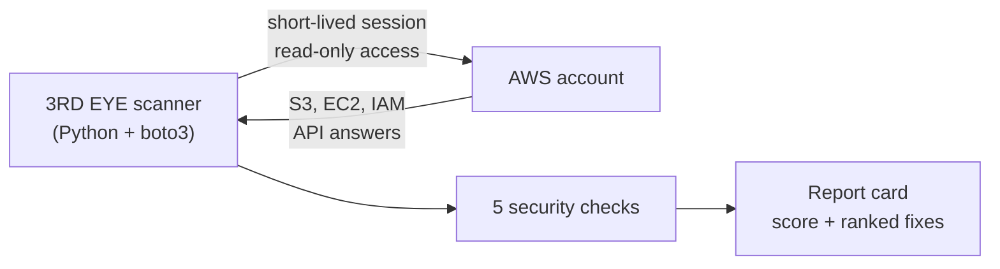

# 3RD EYE Lite 👁️

**An AWS security scanner.** 3RD EYE Lite checks an AWS account for the
misconfigurations attackers look for first, ranks every finding by risk,
explains how to fix it, and gives the account a security score out of 100.


> This is the open **portfolio edition** of 3RD EYE. The full product, in
> private development, adds five more checks (root account MFA and keys,
> access-key age, CloudTrail, GuardDuty) and runs as a cloud service:
> one-click customer onboarding, daily automatic scans, a customer portal
> with MFA logins, and email alerts.

---

## What it checks

| # | Check | Risk if found |
|---|-------|---------------|
| 1 | S3 buckets readable by anyone on the internet | CRITICAL |
| 2 | SSH (port 22) open to the whole internet | HIGH |
| 3 | IAM users who can log in without MFA | HIGH |
| 4 | Unencrypted EBS disks, and default encryption switched off | MEDIUM |
| 5 | Password policy weaker than CIS AWS Foundations guidance | MEDIUM |

Scoring starts at 100: **CRITICAL −25, HIGH −15, MEDIUM −5**, then graded A–F.

## Example report card

Run against two test accounts: one with planted mistakes, one built correctly.

```text
================================================================
  3RD EYE LITE - SECURITY REPORT CARD
  Account profile: messy   Region: us-east-1
================================================================

  SECURITY SCORE: 30/100   GRADE: F

  1. [CRITICAL] S3 bucket is public
     Resource: 3rdeye-planted-public-************
     Fix:      Turn on Block Public Access and remove the public bucket policy.

  2. [HIGH] SSH open to the internet
     Resource: sg-************ (planted-ssh-open-to-world)
     Fix:      Limit port 22 to trusted IP ranges, or use AWS Systems
               Manager Session Manager instead of SSH.
  ...
```

```text
  Account profile: clean   ->   SECURITY SCORE: 100/100   GRADE: A
```

## How it works



## Security by design

- **No long-term keys.** Built and run with `aws login` and short-lived,
  assumed-role credentials. Nothing permanent is stored on disk.
- **Look, don't touch.** The scanner only reads; it never changes the account.
- **Secrets can't slip in.** Gitleaks pre-commit hook locally, Gitleaks in CI
  on every push, and GitHub push protection on the repository.
- **Least-privilege pipeline.** GitHub Actions runs with `contents: read` only.
- **Verified supply chain.** Tool downloads are checked against official
  SHA-256 checksums; dependencies are version-pinned.

## Proving it works

- **Practice accounts built with Terraform** (`practice-house/`): a *messy*
  account with five planted, harmless mistakes and a *clean* account with
  the correct version of each. The scanner must catch 100% of the planted
  mistakes and raise zero false alarms on the clean account.
- **14 automated tests** against a simulated AWS (moto), with a
  "must catch" and a "must not flag" case for every check.
- **CI on every push:** secret scan + full test suite.

## Quick start

```powershell
python -m venv .venv
.\.venv\Scripts\Activate.ps1
python -m pip install -r requirements.txt
aws login --profile <your-profile>
python scanner\scan.py <your-profile>
```

Run the tests (no AWS account needed):

```powershell
python -m pip install -r requirements-dev.txt
python -m pytest -v
```

## Project structure

```text
3rd-eye-lite/
├── scanner/              # 5 checks + scan.py report card
├── test/                 # automated tests (pytest + moto)
├── practice-house/
│   ├── messy/            # Terraform: planted mistakes
│   └── clean/            # Terraform: the correct versions
├── .github/workflows/    # CI pipeline
├── requirements.txt
└── requirements-dev.txt
```

## License

© 2026 Chike Iloabachie. All rights reserved. You're welcome to read and
learn from this code; please get in touch before reusing it.

## Author

**Chike Iloabachie**, Cloud / DevOps Engineer
AWS · Azure · Kubernetes · Terraform · DevSecOps
[LinkedIn](https://linkedin.com/in/chikeiloabachie)

